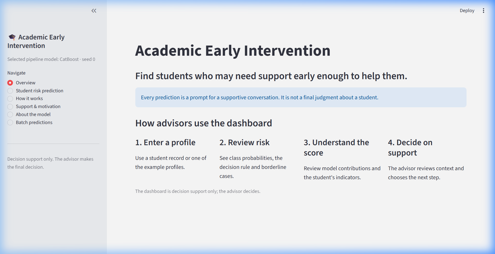
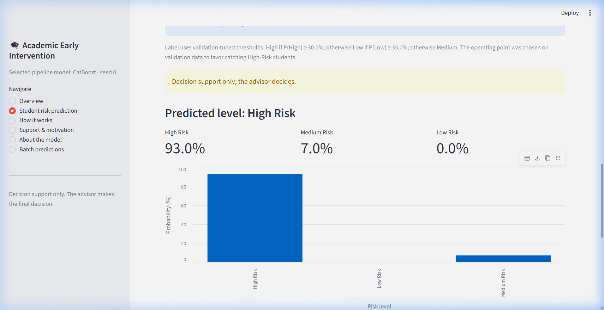
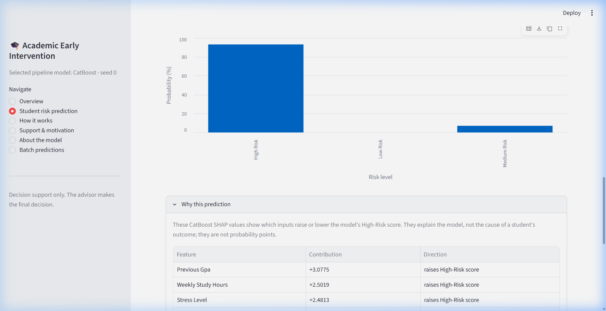
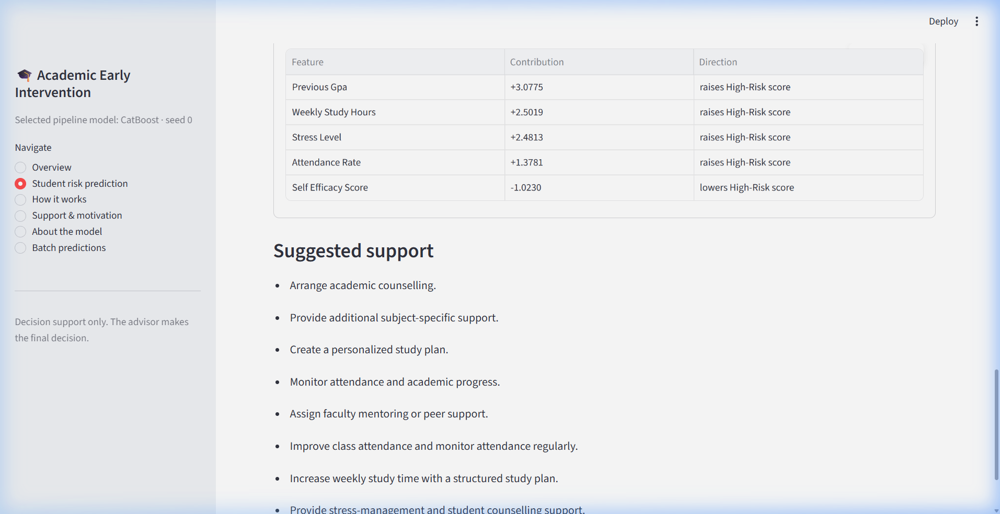
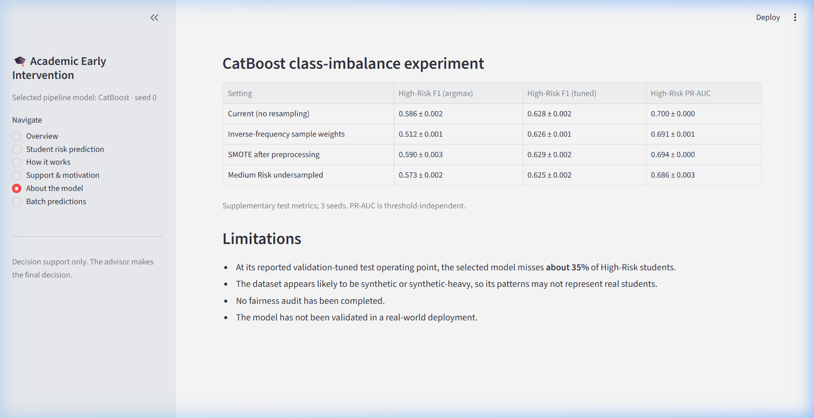

# Academic Early-Intervention Agent 🎓

> **A machine learning decision-support system that identifies undergraduate students at academic risk before final examinations and provides faculty advisors with actionable, profile-tailored intervention guidance.**

[](https://www.python.org/)
[](https://streamlit.io/)
[-yellow.svg)](https://catboost.ai/)
[](https://scikit-learn.org/)
[-EE4C2C.svg)](https://pytorch.org/)

---



---

## Table of Contents

- [Overview & Motivation](#overview--motivation)
- [Key Features](#key-features)
- [Visual Walkthrough (Application Gallery)](#visual-walkthrough-application-gallery)
- [System Architecture & Workflow](#system-architecture--workflow)
- [Model Selection & Evaluation](#model-selection--evaluation)
  - [Comparative Benchmark Results](#comparative-benchmark-results)
  - [Decision Rules & Threshold Tuning](#decision-rules--threshold-tuning)
  - [High-Risk Operating Points](#high-risk-operating-points)
- [Dataset & Feature Engineering](#dataset--feature-engineering)
  - [Target Definition & Imbalance](#target-definition--imbalance)
  - [Raw Attributes](#raw-attributes)
  - [Engineered Features](#engineered-features)
- [Installation & Quick Start](#installation--quick-start)
  - [Prerequisites](#prerequisites)
  - [Setup Environment](#setup-environment)
  - [Run the Streamlit Dashboard](#run-the-streamlit-dashboard)
- [Reproducing the Offline Experiments](#reproducing-the-offline-experiments)
- [Repository Structure](#repository-structure)
- [Limitations & Ethical Considerations](#limitations--ethical-considerations)
- [Future Roadmap](#future-roadmap)
- [Citation](#citation)

---

## Overview & Motivation

In higher education, academic intervention is often reactive—triggered only after students fail midterm exams or receive failing final grades. The **Academic Early-Intervention Agent** reframes academic advising as a proactive, data-informed dialogue.

By synthesizing **23 mid-semester behavioral, environmental, academic, and well-being attributes**, the system:
1. Predicts a student's risk group (**High Risk**, **Medium Risk**, or **Low Risk**) weeks before final assessments.
2. Applies **validation-tuned decision thresholds** designed specifically to combat severe class imbalance (~5.1% High Risk).
3. Breaks down predictions with **CatBoost SHAP feature contributions** to explain why a student was flagged.
4. Generates **context-aware intervention suggestions** tailored to specific risk drivers (e.g., low attendance, high stress, study time deficits).

> **Important Advisory Note:** This tool is strictly a **decision-support aid**. It does not automate disciplinary or grading actions; faculty advisors retain full discretion and responsibility for student support.

---

## Key Features

- **Multi-Class Risk Stratification:** Categorizes students into High, Medium, or Low Risk derived from final exam performance thresholds.
- **Validation-Tuned Decision Thresholds:** Employs optimal decision cutoffs ($t_{\text{high}}=0.30$, $t_{\text{low}}=0.35$ for seed 0) that increase test High-Risk recall from 48.7% (standard argmax) to 65.6% (+16.8 percentage points) while preserving strong precision.
- **Explainable AI (SHAP):** Local Tree SHAP values attribute risk contributions to specific attributes (e.g., low previous GPA, attendance deficits, high stress levels).
- **Automated Support Recommendations:** Rules-driven recommendation engine that translates student indicators into concrete steps (academic tutoring, study plan adjustments, mental health resources).
- **Interactive Streamlit Web Interface:**
  - One-click loading of preset case-study student profiles (**High**, **Medium**, and **Low** risk).
  - Configurable decision sensitivity operating points ($F_1$-optimal, recall $\ge 0.70$, recall $\ge 0.80$, or argmax).
  - Immediate borderline case alerts when top class probabilities fall within 10 percentage points.
- **Batch Processing:** Upload multi-student CSV files, download ranked high-risk prediction queues, and export prioritized intervention rosters.
- **Rigorous 12-Model Offline Pipeline:** Comprehensive benchmarking of linear baselines, tree ensembles (Random Forest, HistGradientBoosting, LightGBM, XGBoost, CatBoost), and deep architectures (MLP, FT-Transformer) over 5-fold cross-validation across 5 random seeds.

---

## Visual Walkthrough (Application Gallery)

### 1. Advisor Workflow Overview
The landing page introduces the 4-step advising framework: profile entry, probability inspection, SHAP interpretation, and support planning.


### 2. Student Risk Prediction & Probability Distribution
Advisors enter student indicators or load sample profiles. The model outputs the risk tier, probability breakdown, and an alert if the student is on a decision borderline.


### 3. Explainable AI: CatBoost SHAP Feature Contributions
The collapsible explanation panel reveals the top factors driving the student's risk score, clarifying the direction and magnitude of each indicator.


### 4. Tailored Intervention Recommendations
A curated list of actionable recommendations combining general risk-tier protocols with student-specific triggers (e.g., stress counseling, study scheduling, peer tutoring).


### 5. Model Performance & Empirical Limitations
Transparent reporting of the 12-model comparative validation benchmarks, test operating points, and empirical trade-offs directly within the UI.


---

## System Architecture & Workflow

```text
[ Student Mid-Semester Data (23 Attributes) ]
                      │
                      ▼
[ Feature Engineering (4 Derived Indicators) ]
  • previous_failure_flag    (Failed Courses > 0)
  • study_engagement_score   (Study Hours + Library Visits)
  • digital_distraction_score(Social Media Hours)
  • learning_support_score   (Internet Quality + Study Space Quality)
                      │
                      ▼
[ Scikit-Learn Pipeline: OneHotEncoder + StandardScaler ]
                      │
                      ▼
[ Validation-Selected CatBoost Classifier (Seed 0) ]
                      │
                      ▼
[ Predicted Class Probabilities: P(High), P(Medium), P(Low) ]
                      │
                      ├───────────────────────────────────────────┐
                      ▼                                           ▼
[ Validation-Tuned Threshold Decision ]              [ Tree SHAP Explanations ]
  • If P(High) >= 0.30  --> High Risk                  Top 5 indicators raising/
  • Else If P(Low) >= 0.35 --> Low Risk                lowering High-Risk score
  • Else                --> Medium Risk                           │
                      │                                           │
                      └─────────────────────┬─────────────────────┘
                                            ▼
                      [ Contextual Intervention Engine ]
                        Attribute-driven rules + tier actions
                                            │
                                            ▼
                      [ Streamlit Advisory Dashboard UI ]
```

---

## Model Selection & Evaluation

The offline pipeline evaluated **12 model architectures** across 5-fold stratified cross-validation and 5 random seeds (70% train, 15% validation, 15% test). Model selection was conducted **strictly on validation set scores** before evaluating the test set.

**CatBoost** achieved the highest validation High-Risk $F_1$ score under both decision rules and was selected for dashboard deployment.

### Comparative Benchmark Results

All metrics below are reported on the final held-out test set ($N=75,000$) as **mean ± standard deviation across all 5 random seeds** directly from `results/summary_table.json`:

| Model | Decision Rule | Accuracy | Macro $F_1$ | High-Risk Precision | High-Risk Recall | High-Risk $F_1$ | High-Risk PR-AUC | Size (MB) |
|---|---|---|---|---|---|---|---|---|
| **CatBoost (Selected)** | **Validation-Tuned** | **0.878 ± 0.000** | **0.746 ± 0.001** | **0.604 ± 0.002** | **0.652 ± 0.004** | **0.627 ± 0.003** | **0.700 ± 0.001** | **4.17** |
| CatBoost | Argmax | 0.888 ± 0.000 | 0.726 ± 0.001 | 0.737 ± 0.003 | 0.488 ± 0.003 | 0.588 ± 0.002 | 0.700 ± 0.001 | 4.17 |
| LightGBM | Validation-Tuned | 0.878 ± 0.001 | 0.743 ± 0.001 | 0.606 ± 0.018 | 0.646 ± 0.019 | 0.625 ± 0.001 | 0.696 ± 0.001 | 6.31 |
| XGBoost | Validation-Tuned | 0.877 ± 0.000 | 0.743 ± 0.000 | 0.603 ± 0.000 | 0.644 ± 0.000 | 0.623 ± 0.000 | 0.689 ± 0.000 | 10.71 |
| FT-Transformer (100k; no CV) | Validation-Tuned | 0.880 ± 0.002 | 0.743 ± 0.002 | 0.603 ± 0.017 | 0.640 ± 0.025 | 0.621 ± 0.004 | 0.685 ± 0.008 | 0.36 |
| HistGradientBoosting | Validation-Tuned | 0.878 ± 0.001 | 0.741 ± 0.001 | 0.607 ± 0.019 | 0.627 ± 0.022 | 0.616 ± 0.002 | 0.690 ± 0.001 | 0.58 |
| MLP (PyTorch; 100k) | Validation-Tuned | 0.877 ± 0.002 | 0.736 ± 0.003 | 0.596 ± 0.009 | 0.628 ± 0.012 | 0.611 ± 0.007 | 0.676 ± 0.006 | 0.11 |
| RF (unconstrained) | Validation-Tuned | 0.868 ± 0.004 | 0.718 ± 0.000 | 0.570 ± 0.003 | 0.595 ± 0.002 | 0.582 ± 0.002 | 0.623 ± 0.001 | 737.03 |
| RF (capped, tuned) | Validation-Tuned | 0.865 ± 0.003 | 0.715 ± 0.001 | 0.541 ± 0.002 | 0.620 ± 0.004 | 0.578 ± 0.002 | 0.613 ± 0.002 | 262.03 |
| Logistic Regression | Validation-Tuned | 0.837 ± 0.000 | 0.652 ± 0.000 | 0.453 ± 0.000 | 0.454 ± 0.000 | 0.453 ± 0.000 | 0.445 ± 0.000 | 0.01 |
| Logistic Regression (balanced) | Validation-Tuned | 0.820 ± 0.000 | 0.640 ± 0.000 | 0.388 ± 0.000 | 0.513 ± 0.000 | 0.442 ± 0.000 | 0.427 ± 0.000 | 0.01 |
| LR (Midterm_Mark only) | Validation-Tuned | 0.789 ± 0.000 | 0.583 ± 0.000 | 0.313 ± 0.000 | 0.464 ± 0.000 | 0.374 ± 0.000 | 0.326 ± 0.000 | <0.01 |
| Majority class (baseline) | Validation-Tuned | 0.823 ± 0.000 | 0.301 ± 0.000 | 0.000 ± 0.000 | 0.000 ± 0.000 | 0.000 ± 0.000 | 0.051 ± 0.000 | 0.01 |

### Decision Rules & Threshold Tuning

Standard argmax classification assumes symmetric class costs. In academic early intervention, failing to flag a student who needs help (false negative) is far costlier than reviewing a borderline student (false positive).

Threshold tuning searches a two-dimensional grid on the validation split:
$$\text{Class} = \begin{cases} \text{High Risk} & \text{if } P(\text{High}) \ge t_{\text{high}} \\ \text{Low Risk} & \text{else if } P(\text{Low}) \ge t_{\text{low}} \\ \text{Medium Risk} & \text{otherwise} \end{cases}$$

- **Seed 0 (Deployed Model):** Validation tuning selected $t_{\text{high}} = 0.30$ and $t_{\text{low}} = 0.35$. On the held-out test set, this increased High-Risk recall from **48.7%** (argmax) to **65.6%** (**+16.8 percentage points**).
- **Across 5 Seeds:** Mean High-Risk test recall increased from **48.8% ± 0.3%** (argmax) to **65.2% ± 0.4%** (**+16.4 percentage points**).

### High-Risk Operating Points

Advisors can adjust the decision sensitivity mode in the dashboard depending on institutional capacity (from `results/operating_points.json`):

| Operating Point | Threshold ($t_{\text{high}}$) | Test Precision | Test Recall | Test $F_1$ | Flagged Share |
|---|---|---|---|---|---|
| **$F_1$-Optimal (Default)** | 0.311 ± 0.016 | 61.3% ± 1.4% | 64.2% ± 1.3% | 0.627 ± 0.003 | 5.4% |
| **High Recall ($\ge 70\%$)** | 0.240 ± 0.002 | 55.6% ± 0.3% | 71.2% ± 0.3% | 0.625 ± 0.001 | 6.6% |
| **Max Outreach ($\ge 80\%$)** | 0.150 ± 0.003 | 46.6% ± 0.4% | 81.2% ± 0.3% | 0.592 ± 0.002 | 8.9% |

---

## Dataset & Feature Engineering

### Target Definition & Imbalance

The target label `Academic_Risk` is derived deterministically from the final examination score:
- **High Risk:** $\text{Final\_Exam\_Score} < 40$ (5.1% of dataset / 25,615 students)
- **Medium Risk:** $40 \le \text{Final\_Exam\_Score} \le 69$ (82.3% of dataset / 411,494 students)
- **Low Risk:** $\text{Final\_Exam\_Score} \ge 70$ (12.6% of dataset / 62,891 students)

> **Dataset Provenance & Privacy:** The 500,000-student dataset is a synthetic educational benchmark. The raw CSV is not distributed within this repository pending ongoing privacy, licensing, and provenance review.

### Raw Attributes

The model ingests 23 raw attributes across four categories:
1. **Academic History:** `Previous_GPA`, `Number_of_Failed_Courses`, `Total_Credits_Earned`, `Semester_ID`, `Midterm_Mark`.
2. **Learning Engagement:** `Weekly_Study_Hours`, `Attendance_Rate`, `Library_Visits_Per_Month`, `Extracurricular_Hours`.
3. **Environment & Demographics:** `Major_Subject`, `Age`, `Gender`, `Region_Type`, `Family_Size`, `Parent_Education`, `Family_Income_Level`, `Internet_Quality`, `Study_Space_Quality`.
4. **Lifestyle & Well-Being:** `Sleep_Hours`, `Social_Media_Usage_Hours`, `Stress_Level`, `Motivation_Score`, `Self_Efficacy_Score`.

### Engineered Features

The pipeline computes 4 interaction features defined in [`src/pipeline/features.py`](src/pipeline/features.py):
- `previous_failure_flag`: Binary indicator whether `Number_of_Failed_Courses > 0`
- `study_engagement_score`: Sum of `Weekly_Study_Hours + Library_Visits_Per_Month`
- `digital_distraction_score`: `Social_Media_Usage_Hours`
- `learning_support_score`: Sum of `Internet_Quality + Study_Space_Quality`

---

## Installation & Quick Start

### Prerequisites

- **Python:** 3.13 (or compatible 3.11+)
- **OS:** Windows, macOS, or Linux

### Setup Environment

1. **Clone the repository:**
   ```bash
   git clone https://github.com/PAYALPJENA/Academic-Early-Intervention-Agent.git
   cd Academic-Early-Intervention-Agent
   ```

2. **Create and activate a virtual environment:**
   ```bash
   # Windows PowerShell
   py -3.13 -m venv .venv
   .\.venv\Scripts\Activate.ps1

   # Linux / macOS
   python3 -m venv .venv
   source .venv/bin/activate
   ```

3. **Install dependencies:**
   ```bash
   pip install --upgrade pip
   pip install -r requirements.txt

   # Optional: install extended gradient boosters & PyTorch
   pip install -r requirements-extras.txt
   ```

### Run the Streamlit Dashboard

Launch the web application locally:

```bash
streamlit run app.py
```

The application will open automatically in your browser at `http://localhost:8501`.

---

## Reproducing the Offline Experiments

The offline experiment pipeline is managed by the unified driver at [`src/pipeline/run_pipeline.py`](src/pipeline/run_pipeline.py). It reads saved checkpoints from `results/runs/` to resume without redundant computation.

```bash
# 1. Inspect available CLI arguments
py -3.13 src/pipeline/run_pipeline.py --help

# 2. Recompute validation-tuned operating points from saved predictions (~15s)
py -3.13 src/pipeline/run_pipeline.py --operating-points-only

# 3. Launch or resume the 12-model pipeline with a 30-minute time budget
py -3.13 src/pipeline/run_pipeline.py --device cpu --time-budget 30

# 4. Optional GPU-accelerated execution (requires CUDA PyTorch & GPU booster builds)
py -3.13 src/pipeline/run_pipeline.py --device cuda --time-budget 30
```

---

## Repository Structure

```text
Academic-Early-Intervention-Agent/
├── .gitignore                      # Exclusion rules for raw datasets, caches & environments
├── README.md                       # Project overview and landing documentation
├── PROJECT_WALKTHROUGH.md          # Technical audit and implementation deep-dive
├── COLAB_RUNBOOK.md                # Google Colab GPU training procedures
├── COLAB_IMBALANCE_RUNBOOK.md      # Resampling and class-imbalance study guide
├── requirements.txt                # Core application and model runtime requirements
├── requirements-extras.txt         # Extended dependencies (XGBoost, LightGBM, PyTorch, Imbalanced-Learn)
│
├── app.py                          # Streamlit advisor dashboard entry point
├── run_imbalance_experiment.py     # Standalone class-imbalance comparison runner
│
├── src/
│   ├── risk_prediction.py          # Dashboard inference engine, SHAP explanations & rules
│   └── pipeline/
│       ├── __init__.py             # Pipeline package definition
│       ├── run_pipeline.py         # Main CLI experiment runner & evaluation driver
│       ├── config.py               # Paths, model hyperparameters & seed settings
│       ├── data.py                 # Dataset loading, labeling & stratified splitting
│       ├── deep.py                 # PyTorch MLP & FT-Transformer architectures
│       ├── features.py             # Feature definitions & scikit-learn transformers
│       ├── metrics.py              # Multi-class metrics, PR-AUC & seed summaries
│       ├── models.py               # Estimator builders for all 12 model families
│       ├── operating_points.py     # High-Risk operating threshold evaluation
│       └── plots.py                # Visualizations (PR curves, confusion matrices, bars)
│
├── models/
│   └── pipeline/
│       └── catboost.joblib         # Validation-selected CatBoost pipeline artifact (3.98 MB)
│
├── old_models/                     # Legacy fallback artifacts
│   ├── gradient_boosting.pkl       # HistGradientBoosting fallback estimator (578 KB)
│   └── preprocessor.pkl            # Fallback preprocessor (5.7 KB)
│
├── results/                        # Evaluation metrics and run records
│   ├── selection.json              # Validation ranking & selected model metadata
│   ├── thresholds_validation.json  # Grid-searched decision thresholds per seed
│   ├── operating_points.json       # Operating point precision/recall trade-offs
│   ├── summary_table.json          # Table A (argmax) and Table B (tuned thresholds)
│   ├── imbalance_experiment.json   # Resampling comparison results
│   ├── tuning_catboost.json        # Hyperparameter search results for CatBoost
│   └── runs/                       # 60 historical per-seed run JSON records (12 models × 5 seeds)
│
├── figures/                        # Evaluation charts & ROC/PR curves
│   ├── class_distribution.png
│   ├── operating_points_high_risk.png
│   ├── pr_curves_high_risk_test.png
│   └── confusion_matrices_test_tuned_thresholds.png
│
├── notebooks/                      # Reviewed Colab replication notebooks
│   ├── colab_run.ipynb             # 12-model GPU training notebook
│   └── colab_imbalance.ipynb       # Resampling study notebook
│
├── report/                         # Manuscript generation tooling
│   ├── build_paper.js              # Word document compiler from results JSON
│   ├── figs.py                     # Report figure exporter
│   ├── package.json
│   └── package-lock.json
│
└── docs/
    └── screenshots/                # Real application UI captures
        ├── dashboard-overview.png
        ├── student-risk-prediction.png
        ├── prediction-explanation.png
        ├── support-recommendations.png
        └── model-performance.png
```

---

## Limitations & Ethical Considerations

1. **Advisory Decision Support Only:** This system is not designed to automate admissions, probation, or academic dismissal. Human advisors must evaluate personal context before taking action.
2. **False Negative Trade-Offs:** Even at the $F_1$-optimal operating point, the model misses approximately **34.8%** of High-Risk students. It should supplement, not replace, regular academic advising check-ins.
3. **Correlation vs. Causation:** SHAP values explain which attributes influenced the model's score; they do not prove that altering an attribute (e.g., forcing sleep hours) will causally change academic outcomes.
4. **Synthetic Data Characteristics:** The dataset is an educational benchmark. Patterns, correlations, and feature distributions may not mirror real university populations.
5. **Fairness & Demographic Bias:** Demographic attributes (`Gender`, `Region_Type`, `Family_Income_Level`) are present in the benchmark dataset. An institutional fairness and disparate impact audit is required prior to real-world deployment.

---

## Future Roadmap

- [ ] **Institutional SIS Integration:** Automated, secure connectors for Canvas, Blackboard, and Banner student information systems.
- [ ] **Longitudinal Tracking:** Evaluating intervention efficacy by measuring student grade trajectory changes across consecutive semesters.
- [ ] **Algorithmic Fairness Audits:** Disparate impact analysis and demographic parity calibration across first-generation and underrepresented student groups.
- [ ] **Federated Learning:** Multi-institution model training without centralizing private student records.

---

## Citation

If you find this framework or codebase helpful for your research or educational technology projects, please consider citing:

```bibtex
@misc{academic_early_intervention_agent,
  author = {Payal P. Jena},
  title = {Academic Early-Intervention Agent: Machine Learning Decision-Support for Student Retention},
  year = {2026},
  publisher = {GitHub},
  howpublished = {\url{https://github.com/PAYALPJENA/Academic-Early-Intervention-Agent}}
}
```
